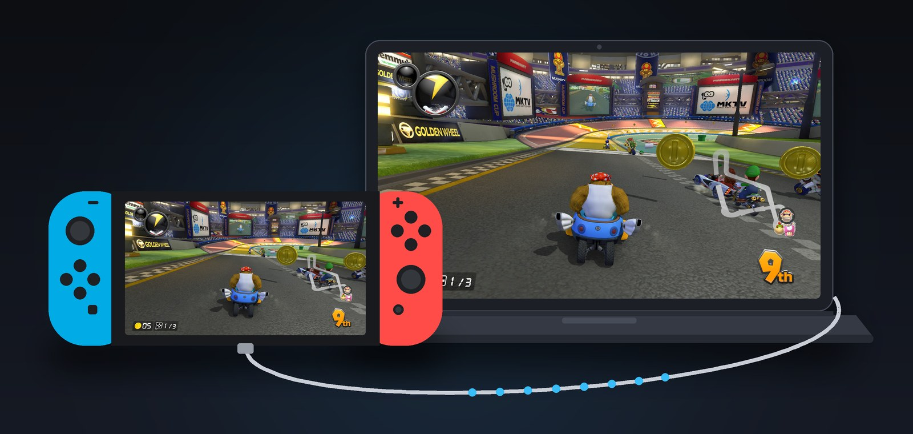

# Switch Remote Frame

> **This is a fork of [Switch Frame Tap](https://github.com/TomasUribe/switch-frame-tap)
> by [TomasUribe](https://github.com/TomasUribe).** Heartfelt thanks to the
> original author for building and open-sourcing the whole streaming stack —
> the sysmodule, the protocol and the viewers this fork stands on. For the
> complete in-depth documentation (the full install guide, how it works
> internally, limitations and the engineering write-up), go to the
> [original repository](https://github.com/TomasUribe/switch-frame-tap).

## What this fork adds

Everything Switch Frame Tap already does, plus:

- **Touch control:** touch the streamed picture on an Android phone or tablet
  and the Switch's touchscreen is touched — play touch-only games without the
  console in your hands.
- **Real gamepad support:** a controller paired to Android or the PC plays as
  a Switch Pro Controller, with a button-remap and test page.
- **On-screen virtual gamepad** on Android *and* PC, with a layout editor
  (drag to move, click to resize or remove, adjust opacity) and a show/hide
  button.
- **Rumble:** the Switch's vibration is felt on your controller or the phone,
  with an opt-in root fallback for Xbox pads.
- **Lower-latency decoding:** decoded frames are presented immediately and
  vendor low-latency decoder options are used where available (Qualcomm,
  MediaTek, Exynos, Kirin, Amlogic), with an automatic fallback.
- **The PC viewer plays, not just watches:** the mouse touches the screen, the
  keyboard and any connected gamepad act as a Pro Controller, rumble comes
  back to the PC's controller, and the same virtual gamepad and editor are in
  the window.
- **Smooth video** pacing for bursty Wi-Fi (off by default; lowest-latency
  picture stays the default), plus Disconnect and Exit buttons and a
  framerate-only counter.
- **macOS Metal FSR 1 upscaling** — GPU upscaling on Mac, where the original
  only supported it on Windows and Linux.
- **A self-updating Linux AppImage**, alongside hardened Windows/Linux/macOS
  self-updaters.
- **A redesigned dark UI on every surface** — the Switch manager, the Tesla
  overlay, the Android / Android TV app and the PC viewer share one modern
  design system, with ten-foot TV focus, an inline IP address field and
  network connection by default.

---

**Stream your Nintendo Switch games to your PC, with sound, at up to 1080p
60 fps, over a USB cable or your network. No capture card needed.**

Switch Remote Frame is a sysmodule (a small background program) for Switch
consoles running Atmosphère custom firmware. Install it on the SD card, open
the viewer on your PC, start a game.

  

   
  <a href="https://youtu.be/AsY-5KIC_1s">Watch the demo (1:43)</a>: connecting, the HOME menu and overlays, 1080p60, the Switch Lite, a 480 fps latency test

## Features

- **Up to 1920x1080 at 60 fps**, the game's own resolution, encoded by the
  console's hardware H.264 encoder.
- **USB or network**: a USB-C cable in handheld mode, Wi-Fi or LAN when docked.
- **Game sound** included, also in games that block recording (optional).
- **Low latency**: about 45 ms (720p) to 60 ms (1080p) from the game to your PC.
- **Viewers for Windows, Linux, macOS and Android / Android TV**, with one Settings panel for everything.
- **The HOME menu and the console's overlays** can stream too (opt-in): the
  volume bar, the quick settings, the power menu and Tesla / Ultrahand menus
  on top of the game.
- **Updates from the apps**: the Switch app, the PC viewers and the Android
  app check GitHub and update themselves.
- **Record to MP4** with one key, and take **native-resolution screenshots**.
- **Webcam mode**: the Switch shows up as a USB camera in OBS, Discord, Zoom
  or any camera app.
- **Optional GPU upscaling** in the viewer (AMD FSR 1, NVIDIA NIS, RTX Video
  Super Resolution on Windows).
- **Screen off while streaming**, to save battery when you play on the PC.
- **A Switch app and an overlay** for every setting, so you never have to edit
  files.

## What you need

- A Switch running [Atmosphère](https://github.com/Atmosphere-NX/Atmosphere/releases)
  (firmware 21 to 23; tested on 22.5.0 with Atmosphère 1.11.2, users run 23.0.0 and 23.0.1 with 1.12)
- A PC with Windows 10/11, Linux or macOS 12+ - or an Android / Android TV
  device (Android 6+, over the network)
- A USB-C to USB-A cable, or the Switch and the PC on the same network

## Quick start

1. Download the `-switch.zip` from the
   **[latest release](https://github.com/monkadev/SwitchRemoteFrame/releases/latest)**,
   unzip it onto the root of the SD card and reboot.
2. Download the viewer for your PC from the same release:
   - **Windows:** unzip it and install the USB driver once with
     [Zadig](https://zadig.akeo.ie/) ([how, in the original guide](https://github.com/TomasUribe/switch-frame-tap#install)), then open `SwitchRemoteFrame.exe`.
   - **Linux:** unpack it and run the install script ([how, in the original guide](https://github.com/TomasUribe/switch-frame-tap#install)) — or use the AppImage, which runs as-is.
   - **macOS:** unzip it, drag the app to Applications, right-click it and choose **Open**.
   - **Android / Android TV:** install the `-android.apk` with a file manager
     that can install apps, and set the Switch's Connection to **Network**.
3. Plug the Switch into the PC (handheld), open the viewer and start a game.
   To stream over the network instead (to play docked, or to a TV with the
   Android app), set
   **Connection** to **Network** in the Switch app, restart the console, and
   pick **Network** in the viewer (**Tab**).

After that, the apps keep themselves up to date: the Switch app's **Updates**
page and the viewers' **Update** button install new versions from GitHub.

The full guide, with every option, is in the [Install section of the original
repository](https://github.com/TomasUribe/switch-frame-tap#install).

## Good to know

- **USB only works in handheld mode**, because the dock uses the USB port.
  When docked, stream over the network.
- **1080p over USB** needs [ReverseNX-RT](https://github.com/masagrator/ReverseNX-RT)
  to make the game render its docked picture in handheld; docked over the
  network it is 1080p by itself.
- **It starts about 30 seconds after the console boots**, once the HOME menu
  is up, so it never takes memory the system needs while booting.
- **Running many sysmodules?** They all share a few MB of system memory. If
  the others leave too little, Switch Remote Frame simply does not start (the
  console boots normally); the Switch app's **Setup** page (System memory)
  says how much each sysmodule uses.
- **The HOME menu and the overlays** (volume bar, quick settings, power menu,
  Tesla / Ultrahand) stream only if you turn them on, on the app's **Beta**
  page; with them off it streams exactly as before.
- **It is experimental homebrew**, tested on a few consoles and games. Read
  [the limitations in the original guide](https://github.com/TomasUribe/switch-frame-tap#limitations)
  before installing.

## Support

If you like the project and want to support it, you can
[buy me a coffee on Ko-fi](https://ko-fi.com/monkadev). Thank you!

---
